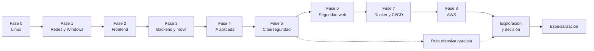

# Ruta: Fullstack → DevSecOps y seguridad ofensiva

Ruta de estudio de ~20–24 meses (10 h/semana) con enfoque mixto: construir y proteger (DevSecOps) y atacar (pentesting y red team). La especialización se decide al final, después de probar ambos lados.

## Progreso

| Fase | Tema | Duración | Estado |
|---|---|---|---|
| Fase 0 | Fundamentos, terminal y Linux | 8–10 semanas | ⬜ |
| Fase 1 | Redes, internet y Windows | 9–11 semanas | ⬜ |
| Fase 2 | Fullstack I: frontend | 12–14 semanas | ⬜ |
| Fase 3 | Fullstack II: backend, bases de datos y móvil | 16–18 semanas | ⬜ |
| Fase 4 | Inteligencia artificial aplicada | 8–10 semanas | ⬜ |
| Fase 5 | Fundamentos de ciberseguridad | 8–10 semanas | ⬜ |
| Fase 6 | Seguridad web, APIs e IA | 8–10 semanas | ⬜ |
| Fase 7 | DevOps: Docker y CI/CD | 8–10 semanas | ⬜ |
| Fase 8 | Nube con AWS | 12–14 semanas | ⬜ |
| — | Ruta ofensiva paralela | Desde la Fase 5 | ⬜ |
| — | Exploración y decisión | 4–6 semanas | ⬜ |
| — | Especialización | Continua | ⬜ |

## Estructura

- `fase-*/` — README con temas, más `apuntes/`, `ejercicios/` y `proyecto/`.
- `ruta-ofensiva/` — hitos, `writeups/`, `laboratorio/`, `herramientas/`.
- `exploracion-decision/` — los dos mini proyectos y tu decisión.
- `especializacion/` — caminos posibles.
- `transversales/` — habilidades en paralelo.
- `plantillas/` — apuntes, writeup, informe de seguridad, ADR.
- `bitacora.md` — registro semanal.

## Reglas

- Cada fase termina con un proyecto en GitHub.
- 30% teoría, 70% práctica.
- Práctica ofensiva solo en plataformas, tu laboratorio o con permiso por escrito.
